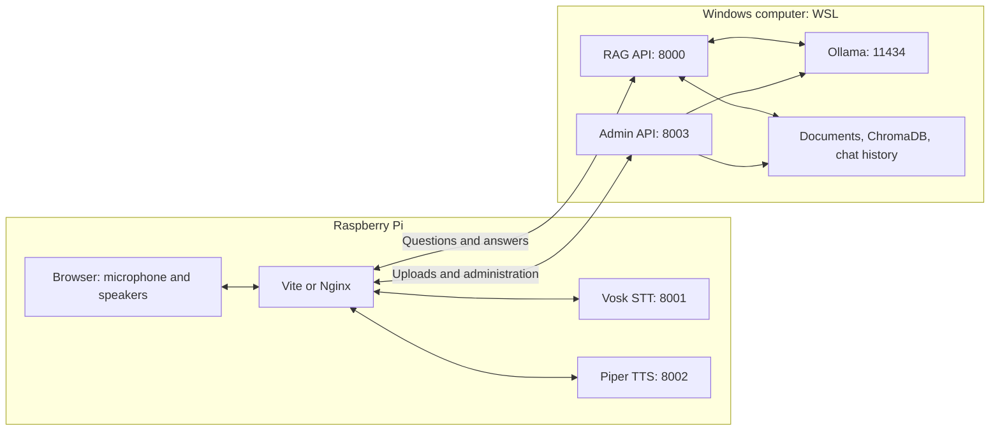

# WSL backend and Raspberry Pi kiosk setup

This guide deploys the existing web application across two devices. Run ingestion,
retrieval, embeddings, reranking, response generation, and storage inside WSL.
Run the UI, speech recognition (STT), and speech synthesis (TTS) on the Raspberry Pi.

Use this guide for the split deployment instead of the README's older instructions
to copy the vector index to the Pi. `python aichatbot.py` is an all-in-one terminal
application; it is not the entry point for this deployment.

## 1. Architecture and prerequisites



RAG and Admin run in one Python process, sharing a lock and retriever. Ingestion
temporarily blocks chat and refreshes search afterward. Audio stays on the Pi:
the browser sends WAV audio to local Vosk and receives WAV audio from local Piper.

| Component | Device | Address/port |
| --- | --- | --- |
| RAG API | WSL | `0.0.0.0:8000` |
| Admin API | WSL, same process as RAG | `0.0.0.0:8003` |
| Ollama | WSL | `127.0.0.1:11434` |
| STT API | Pi | `127.0.0.1:8001` |
| TTS API | Pi | `127.0.0.1:8002` |
| UI development server | Pi | `127.0.0.1:5173` |
| UI production server | Pi | Nginx, port `80` |

You need:

- A Windows computer with WSL 2 and Ubuntu, and sufficient RAM/disk for the models.
- A Pi running 64-bit Raspberry Pi OS, with a desktop browser, microphone, and speakers.
- Both devices on the same trusted LAN, with stable addresses or DHCP reservations.
- Internet access for initial package/model downloads.
- The project source on both devices. Create a separate Linux virtual environment
  on each; do not copy `Scripts`, `Lib`, or an existing virtual environment between devices.

Examples below use `~/RAG` as the checkout directory on each device. Substitute
your actual path, including `/mnt/c/Users/USER/Documents/AIOK/RAG` if using the
existing checkout in WSL. Keep all backend commands in the same checkout so
relative document/index paths resolve consistently.

Example LAN addresses (replace throughout): Windows computer `192.168.1.50`,
Pi `192.168.1.60`. The Pi connects to the Windows LAN address in the NAT setup below.

## 2. Prepare the backend in WSL

In an Ubuntu WSL terminal:

```bash
cd ~/RAG
sudo apt update
sudo apt install -y python3-venv python3-pip build-essential curl libgl1 libglib2.0-0
python3 -m venv .venv
source .venv/bin/activate
python -m pip install --upgrade pip
python -m pip install -r requirements.txt
python -m pip check
```

The current `requirements.txt` is a broad environment snapshot, including optional
packages, rather than a minimal backend lockfile. If a pinned package has no wheel
for your Python/platform, resolve that package's compatibility before proceeding;
installation on a fresh WSL system has not been verified by this guide.

### Install Ollama and models

Install Ollama inside WSL using the [official Linux instructions](https://docs.ollama.com/linux):

```bash
curl -fsSL https://ollama.com/install.sh | sh
ollama list
```

If the server is not running, start `ollama serve` in another WSL terminal and keep
it running. Do not start a second instance if the installed service is already active.

```bash
ollama pull embeddinggemma
ollama pull phi4-mini:3.8b
ollama list
curl --fail http://127.0.0.1:11434/api/tags
```

Keep Ollama local to WSL; the Pi only needs the two application API ports.

### Configure the backend

Create or edit `~/RAG/.env`, preserving any existing settings:

```dotenv
OLLAMA_BASE_URL=http://127.0.0.1:11434
EMBED_MODEL=embeddinggemma
OLLAMA_EMBED_TIMEOUT=120
LLM_MODEL=phi4-mini:3.8b
DOCS_DIR=./docs
INDEX_DIR=./chromadb_index
COLLECTION_NAME=kiosk_docs
CHAT_DB_PATH=./chat_history.sqlite3
CHUNK_TOKENIZER=sentence-transformers/all-MiniLM-L6-v2
RERANK_MODEL=cross-encoder/ms-marco-MiniLM-L-6-v2
ADMIN_PIN=replace-with-your-own-pin
```

Replace the PIN before starting the backend. The code otherwise defaults to
`123456`. Ingestion and chat must use the same embedding model, index directory,
and collection. Hugging Face tokenizer/reranker and document-conversion models
may download on first use, even though embeddings and generation use Ollama.

### Ingest documents and start the APIs

Put PDF, DOCX, PPTX, or HTML files in the WSL checkout's `docs/` directory:

```bash
cd ~/RAG
source .venv/bin/activate
mkdir -p docs
python ingest.py
python ingest.py --test-query "What are the requirements for graduation?"
python api.py --host 0.0.0.0 --port 8000 --admin-port 8003
```

Keep the API terminal running. In another WSL terminal:

```bash
curl --fail http://127.0.0.1:8000/api/health
curl --fail http://127.0.0.1:8003/api/health
```

Expect `status: ready` with services `rag` and `admin`. Health reports service
startup, not a live Ollama inference check.

For a deliberate full rebuild, stop the API, back up the existing index, then run
`python ingest.py --reset`. This deletes the configured collection and ingestion
cache. Restart the API afterward. Do not run standalone ingestion concurrently
with the API; use Admin ingestion while the API is running.

## 3. Make WSL reachable from the Pi

Binding to `0.0.0.0` is necessary but does not by itself make a WSL 2 NAT guest
reachable from the LAN. Choose the procedure appropriate to your networking mode.
See [Microsoft's WSL networking documentation](https://learn.microsoft.com/windows/wsl/networking).

### Default NAT networking

In Windows PowerShell, find the distro name and its current address:

```powershell
wsl --list --verbose
wsl -d Ubuntu hostname -I
ipconfig
```

Replace `Ubuntu` with your distro name. Use its WSL IPv4 address as `connectaddress`
below; use the Windows LAN IPv4 from `ipconfig` as `listenaddress`.

In **PowerShell as Administrator**, replace the sample addresses before running:

```powershell
netsh interface portproxy add v4tov4 listenaddress=192.168.1.50 listenport=8000 connectaddress=172.20.10.5 connectport=8000
netsh interface portproxy add v4tov4 listenaddress=192.168.1.50 listenport=8003 connectaddress=172.20.10.5 connectport=8003
New-NetFirewallRule -DisplayName "AIOK backend from Pi" -Direction Inbound -Action Allow -Protocol TCP -LocalPort 8000,8003 -RemoteAddress 192.168.1.60 -Profile Private
netsh interface portproxy show all
```

The firewall rule assumes your trusted LAN uses the Windows Private profile.
The WSL address may change after restart; update both portproxy entries with
`netsh interface portproxy set v4tov4` and the same arguments when it changes.

### Existing mirrored networking

If WSL already uses mirrored networking, skip NAT portproxy rules. Allow inbound
TCP 8000 and 8003 through the applicable Windows/Hyper-V firewalls, restricted
to the Pi. Microsoft's linked guide explains mirrored networking prerequisites
and Hyper-V rules. Avoid changing networking modes merely to follow this guide.

### Verify from the Pi

With the WSL API running, execute on the Pi:

```bash
curl --fail --connect-timeout 5 http://192.168.1.50:8000/api/health
curl --fail --connect-timeout 5 http://192.168.1.50:8003/api/health
```

Both must succeed before configuring the UI. Keep these ports restricted to the
Pi: RAG has no authentication, and Admin uses PIN-based sessions. Do not expose
them through an internet router. Keep the Windows computer awake during kiosk use.

## 4. Install speech services on the Pi

Use the project source on the Pi, but keep documents, ChromaDB, Ollama, and the chat
database on WSL. The existing `requirements_pi.txt` includes backend dependencies;
use the speech-only installation below for this deployment.

```bash
cd ~/RAG
sudo apt update
sudo apt install -y python3-venv python3-pip libportaudio2 curl unzip
python3 -m venv .venv
source .venv/bin/activate
python -m pip install --upgrade pip
python -m pip install -r requirements_stt.txt piper-tts==1.8.0
python -m pip check
```

Download the [small English Vosk model](https://alphacephei.com/vosk/models):

```bash
mkdir -p models
curl -L --fail https://alphacephei.com/vosk/models/vosk-model-small-en-us-0.15.zip -o /tmp/vosk-model.zip
unzip /tmp/vosk-model.zip -d models
```

For Piper, check whether `voices/en_US-lessac-medium.onnx` and the matching
`voices/en_US-lessac-medium.onnx.json` already exist in your checkout. If missing:

```bash
mkdir -p voices
cd voices
python -m piper.download_voices en_US-lessac-medium
cd ..
```

See the [Piper project](https://github.com/OHF-Voice/piper1-gpl) for model and package details.

Start STT in one Pi terminal:

```bash
cd ~/RAG
source .venv/bin/activate
export VOSK_MODEL="$PWD/models/vosk-model-small-en-us-0.15"
python stt_api.py --host 127.0.0.1 --port 8001
```

Start TTS in another Pi terminal:

```bash
cd ~/RAG
source .venv/bin/activate
python tts_api.py --host 127.0.0.1 --port 8002 --tts --tts-model "$PWD/voices/en_US-lessac-medium.onnx"
```

The standalone speech APIs do not load `.env`. Export `VOSK_MODEL`/`PIPER_MODEL`
in the process environment, or pass `--tts-model` as above. `--tts` is required
to enable synthesis. The browser handles capture and playback, so the HTTP speech
services do not need to access a microphone or speaker device directly.

Check both in another Pi terminal:

```bash
curl --fail http://127.0.0.1:8001/api/health
curl --fail http://127.0.0.1:8002/api/health
curl --fail http://127.0.0.1:8002/api/tts -H 'Content-Type: application/json' -d '{"text":"The kiosk speech service is ready."}' --output /tmp/aiok-speech.wav
```

Expect `stt_enabled: true` and `tts_enabled: true`. STT loads its model lazily,
so a real transcription is still needed to validate the model. Open the WAV with
the Pi desktop's audio player to verify sound output.

## 5. Start the UI on the Pi for development

Install Node.js and npm on the Pi. The committed Vite lockfile requires Node
`20.19+` in the 20.x series, or `22.12+`. Check `node --version` and `npm --version`.
Use the [official Node.js downloads](https://nodejs.org/en/download) if your OS
package is older than the required version.

```bash
cd ~/RAG/aiok_ui
npm ci
VITE_RAG_API=http://192.168.1.50:8000 VITE_ADMIN_API=http://192.168.1.50:8003 npm run dev -- --host 127.0.0.1
```

Open the printed URL, normally `http://localhost:5173`, **in the Pi's browser**.
Use localhost for microphone access. The default voice targets already point to
`127.0.0.1:8001` and `127.0.0.1:8002` on the machine running Vite.

For persistent development settings, create `aiok_ui/.env.local`:

```dotenv
VITE_RAG_API=http://192.168.1.50:8000
VITE_ADMIN_API=http://192.168.1.50:8003
VITE_STT_API=http://127.0.0.1:8001
VITE_TTS_API=http://127.0.0.1:8002
```

Then use `npm run dev -- --host 127.0.0.1`. Restart Vite after changing targets.
These values configure the Vite proxy, not a production static build. Never put
admin credentials in `VITE_` variables.

## 6. Serve the production UI with Nginx on the Pi

After development works, build and publish the static UI locally on the Pi:

```bash
cd ~/RAG/aiok_ui
npm ci
npm run build
sudo apt install -y nginx
sudo mkdir -p /var/www/aiok-ui
sudo cp -a dist/. /var/www/aiok-ui/
sudo cp ../deploy/nginx.conf.example /etc/nginx/sites-available/aiok
sudo nano /etc/nginx/sites-available/aiok
```

Replace both `192.168.1.50` upstream addresses if your backend address differs.
The example serves `/var/www/aiok-ui` and already routes STT/TTS locally.

On a dedicated kiosk using the default Debian/Raspberry Pi OS Nginx layout,
disable the default site's symlink if present, then enable the kiosk:

```bash
sudo unlink /etc/nginx/sites-enabled/default
sudo ln -s /etc/nginx/sites-available/aiok /etc/nginx/sites-enabled/aiok
sudo nginx -t
sudo systemctl enable --now nginx
sudo systemctl reload nginx
```

Skip `unlink` if the default link is absent and skip `ln` if already enabled.
On a Pi serving other sites, integrate the server block with that configuration
instead. For slower speech synthesis, add `proxy_read_timeout 300s;` inside the
`/api/tts` location; the example otherwise uses Nginx's default timeout there.

Open `http://localhost` in the Pi browser. Nginx replaces Vite; all Python services
must still be running. Do not run both UI servers on port 80. Access from another
device requires HTTPS for microphone capture and uses that device's microphone
and speakers, so it does not represent the intended Pi kiosk setup.

## 7. Verify the complete workflow

1. Open the Pi UI and send a typed question about an ingested document. Confirm
   an answer appears and the WSL API terminal receives `/api/chat`.
2. Click the microphone, allow permission, speak, and stop recording. Confirm a
   transcript appears in the draft and the Pi STT terminal receives `/api/stt`.
3. Send the transcript. Confirm the Pi TTS service receives `/api/tts` and the
   answer plays through the Pi speakers. Use the browser's audio controls if
   automatic playback is blocked.
4. Open Settings, enter the configured PIN, and open Admin. Upload a small supported
   document, run ingestion, and wait for success. Verify the file appears in the
   WSL `docs/` directory and ask a question answered by it.
5. Inspect Admin chat history to confirm completed responses are stored on WSL.

For an independent backend generation check, run on the Pi (allow time for the
first model load):

```bash
curl --fail http://192.168.1.50:8000/api/chat -H 'Content-Type: application/json' -d '{"question":"What are the requirements for graduation?","history":[]}'
```

This creates a normal saved chat exchange. A successful response includes `answer`
and `sources`. Through the UI proxy, `/api/health` checks only RAG; check the STT,
TTS, and Admin ports directly for their individual health responses.

## 8. Restart, maintenance, and troubleshooting

Manual startup order:

1. Start WSL and Ollama; confirm the models are available.
2. Activate the WSL environment and start `api.py` from the repository root.
3. For NAT, check the current WSL IP and update Windows portproxy if needed.
4. Start Pi STT and TTS from the Pi repository root.
5. Start Vite, or use the enabled Nginx service; open the Pi browser.

Closing a Python service terminal stops that service. Nginx's automatic startup
does not start Python or WSL. For unattended operation, configure a process manager
with the correct working directory, absolute virtual-environment Python path,
speech environment variables, and the same commands above. Windows must also start
the WSL backend and keep its network forwarding current after reboot.

Keep `docs/`, `chromadb_index/` (including `.ingest_state.json`), and
`chat_history.sqlite3` backed up on WSL. Stop the backend for a consistent simple
file backup. Do not synchronize a live Chroma directory between devices. Restart
the backend after standalone ingestion; Admin ingestion refreshes it automatically.
Changing the embedding model requires rebuilding the vectors. The semantic answer
cache is in memory and resets when the backend restarts.

| Symptom | Check |
| --- | --- |
| Pi cannot reach backend health | WSL API running, `--host 0.0.0.0`, correct Windows LAN IP, NAT forwarding destination, Windows/Hyper-V firewall, LAN client isolation. |
| UI sends requests to Pi port 8000 | Set both remote Vite targets and restart Vite, or correct both Nginx upstreams. |
| Nginx returns 502 | Confirm the corresponding Python service is running and its configured address is reachable from the Pi. |
| Chat reports unavailable | Check WSL logs, Ollama `/api/tags`, model names, ingested documents, and matching index settings. |
| Chat reports busy during ingestion | Wait for Admin ingestion to finish; the shared lock intentionally blocks generation during index changes. |
| Microphone unavailable | Open UI on Pi localhost, allow microphone permission, select the correct input device in the browser/OS. |
| STT health succeeds but transcription fails | Check extracted Vosk directory, exported `VOSK_MODEL`, and Pi logs; health does not load the model. |
| TTS reports disabled | Restart `tts_api.py` with `--tts` and verify both voice files exist. |
| TTS succeeds but no sound | Check Pi audio output, browser mute/autoplay settings, and play the downloaded test WAV. |
| Speech ignores `.env` | Export variables before starting standalone speech APIs; they do not call `load_dotenv()`. |
| Works until Windows restart | Restart WSL/backend, confirm the host stays awake, and update NAT forwarding for the new WSL IP. |

The repository's API tests use mocked processing and do not prove model installation,
hardware audio, or cross-device networking. Complete the checks above on both real
devices before treating the deployment as ready.
